# Architecture

## One request

```mermaid
flowchart LR
  S0["Message in: A web app"]
  S1["Sign-in, role: Email magic link, Google sign-in"]
  S2["Rate limit: customer + user"]
  S3["Build context: state"]
  S4["Model call: deepseek-flash"]
  S5["Check reply: schema + rules"]
  S6["Tools, approval: agent loop + 5 skills"]
  S7["Save: SQLite"]
  S8["Reply: to the customer"]
  S0 --> S1
  S1 --> S2
  S2 --> S3
  S3 --> S4
  S4 --> S5
  S5 --> S6
  S6 --> S7
  S7 --> S8
```

- **Message in**: The request arrives from a web app or web chat.
- **Sign-in, role**: People sign in (email magic link, google sign-in); every step below knows the tenant and the role, and the role’s permission is checked first (docs/AUTH.md).
- **Rate limit**: An atomic counter refuses calls over the plan (Module 6).
- **Build context**: Stable parts first, then knowledge, memory and the request (Module 7).
- **Model call**: 3 AI features on deepseek-flash, from your server with the key in .env (Modules 1 and 4).
- **Check reply**: Code checks what goes in (a length limit on what users send, screen for prompt injection, remove personal data the task does not need, filter harmful content) and every reply (the schema, the business rules, no banned words or promises, the language and tone); on failure: repair once, then human review (Modules 2 and 4).
- **Tools, approval**: Look-ups only, each checked by the harness. The agent loads only the skills a request needs (Module 11).
- **Save**: Records with the tenant id, the memory, and a safe log line.
- **Reply**: The checked reply goes back.

## Parts
- Code: React (with Vite) · Python 3.12, FastAPI · SQLite. Details in docs/STACK.md.
- Data: SQLite; tenancy: one database, tenant id on every row and key. Tables in docs/DATA_MODEL.md.
- Model: deepseek · deepseek-flash; your key (you bill the customer); called from the server. Settings in docs/AI_SETTINGS.md.
- Sign-in: Email magic link, Google sign-in. Roles and permissions in docs/AUTH.md.
- Integrations: Flowise Prediction API for AI Chatbot, personalized financial analysis, and financial scenario explanations.. Platforms: A web app, An API for other software.
- Billing: Manual invoices at first. Keep only the provider’s customer id; verify every webhook.
- Hosting: One server (VPS) with Docker, over HTTPS, with daily backups and an uptime check.

## Personal data (PDPA)
- Personal data: yes. Kept for: one year.
- Collect only what the features need; say why in a privacy notice.
- Logs hold no message text. Customers can ask for their data and for deletion.
- Plan what you do if data leaks: who you tell, and how fast.

## Ready before the first customer
- [x] A privacy notice (PDPA)
- [x] Terms of service
- [x] Sign-up and a guided first task
- [x] A support channel: email or WhatsApp
- [x] Daily backups, restored once
- [x] Uptime monitoring with an alert to your phone
- [x] Product analytics, without personal data

## Environment variables (.env, never committed)
- `APP_SECRET`
- `DATABASE_PATH`
- `DEEPSEEK_API_KEY`
- `EMAIL_API_KEY`
- `GOOGLE_CLIENT_ID`
- `GOOGLE_CLIENT_SECRET`
