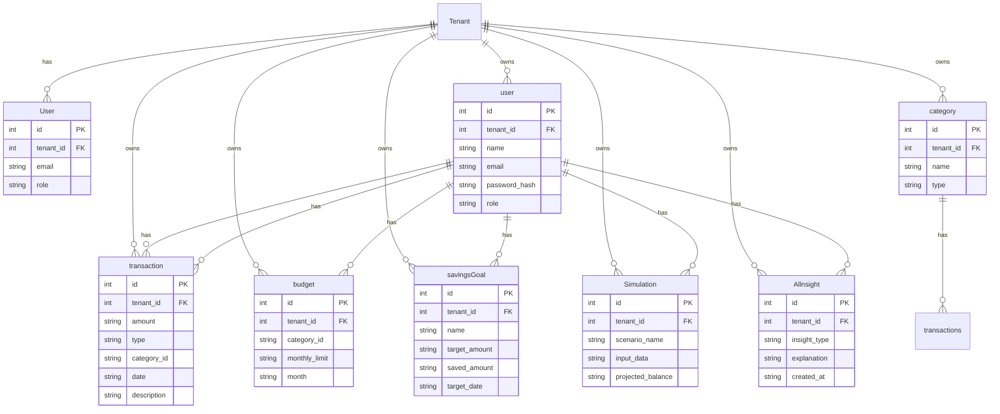

# Data model

Every table has an `id` and a `tenant_id`, and every query filters by the tenant. Add indexes for every list and search.

## user
- `name`: string
- `email`: string
- `password_hash`: string
- `role`: string
- has many transaction

## transaction
- `amount`: string
- `type`: string
- `category_id`: string
- `date`: string
- `description`: string
- belongs to user

## category
- `name`: string
- `type`: string
- has many transactions

## budget
- `category_id`: string
- `monthly_limit`: string
- `month`: string
- belongs to user

## savingsGoal
- `name`: string
- `target_amount`: string
- `saved_amount`: string
- `target_date`: string
- belongs to user

## Simulation
- `scenario_name`: string
- `input_data`: string
- `projected_balance`: string
- belongs to user

## Allnsight
- `insight_type`: string
- `explanation`: string
- `created_at`: string
- belongs to user

